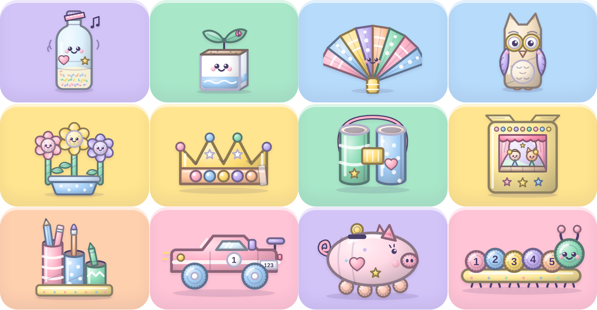
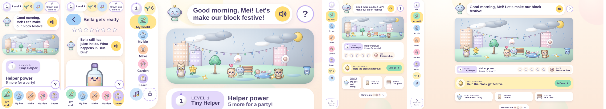

# Bitsy's Maker Bin

A tablet game for kindergarten children (ages 4–6) in Singapore about reusing, recycling and making crafts from things at home. Children help Bitsy the robot sort, clean and make, and their neighbourhood grows as they play.

## What's inside

- **My world** – an HDB neighbourhood that grows with every good choice: plants to water, litter to pick up, animal friends (a community cat, an otter, a hornbill and a pangolin), treasures, weather and day/night.
- **My bin** – children count what is in their recycling bin at home.
- **Make** – 12 step-by-step crafts from tubes, boxes, caps, cartons and bottles, plus an "invent your own" mode. Cutting, rinsing and small parts are always marked as grown-up jobs.
- **Learn** – short stories and games in three stages (Care, Reuse, Sort), an inspection station and a "where does it go?" sorter. Recycling rules follow NEA guidance.
- **Game system** – levels, a helper card, rewards for the world, helper-power parties and a festive event.
- **Guidance** – three help levels (show me, hints, I can do it), first-time tours and a pointing hand.
- **For grown-ups** – a hold-to-open area with settings, photo approval and a pilot-test page. Pilot data has no names.

## Playing it

Open `index.html` in a browser. It works on phones, tablets and desktops, in portrait and landscape.

Some features (the shared class garden and photo checking) only work when the game runs as a Claude artifact. Everywhere else they are hidden and the rest of the game works normally. Progress is saved in the browser on that device.

## Privacy

- No accounts and no personal details are needed.
- Photos stay private until a grown-up approves them.
- Pilot sessions use labels like "Child B", never names.

